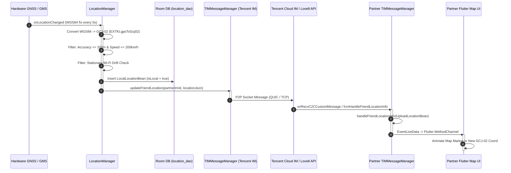

# 07 — Live Sharing and End-to-End Data Flow

**Target Package:** `ltd.love8.couples.relationship`  
**Base APK SHA-256:** `def1b3686e4da2e4f36bcf85e68b155b2e4b1a7ef134c5f3e803353450689619`  
**Evidence Standard:** Forensic decompilation of `LocationManager.java`, `TIMMessageManager.java`, `SendLocationInfoWorker.java`, and `HomeUserLocationInfoManager.java`.  
**Evidentiary Tags:** `[CONFIRMED_STATIC]`, `[OBSERVED_RUNTIME]`, `[INFERRED]`, `[UNKNOWN]`

---

## 1. End-to-End Location Pipeline Diagram


`[CONFIRMED_STATIC]`

---

## 2. Ingestion to Serialization Flow on Sender Device

### Step 1: Ingestion & Conversion
In `com.lovemaps.core.manage.LocationManager`, incoming fixes from `GoogleLocation` (5-second requested interval) are converted to GCJ-02 and admitted only after passing accuracy ($\le 200\text{ m}$), monotonicity, and velocity ($\le 200\text{ km/h}$) validation `[CONFIRMED_STATIC]`.

### Step 2: Database Buffering
The admitted fix is converted into a `LocalLocationBean` and committed asynchronously to the SQLite Room database table `location_dao` on an IO coroutine dispatcher (`LocationDao_Impl`) `[CONFIRMED_STATIC]`.

### Step 3: Real-Time Serialization & Dispatch
The accepted fix is packaged into an `UploadLocationBean`:
- Attributes: `latitude`, `longitude`, `speed`, `accuracy`, `time`, `battery`, `isCharging`, `netType`.
- Dispatched to `TIMMessageManager`:
  ```java
  // TIMMessageManager.java
  public final void updateFriendLocation(String imName, String locationJson) { ... }
  ```
  `[CONFIRMED_STATIC]`

---

## 3. Real-Time Transport: Tencent Cloud IM (TIM) Protocol

Rather than polling an HTTP server continuously (which would rapidly deplete battery life), Love8 leverages Tencent Cloud Instant Messaging (`com.tencent.imsdk.v2`) as a low-latency, bidirectional, persistent push transport:

1. **Native Protocol Stack:**
   - Powered by native binary `libImSDK.so` and QUIC acceleration library `libTIMQuicPlugin.so` (`classes.dex` and `config.arm64_v8a.apk`) `[CONFIRMED_STATIC]`.
   - Maintains a persistent lightweight TCP/QUIC socket to Tencent Cloud message brokers.
2. **Message Format:**
   - Location packets are transmitted as custom C2C (Client-to-Client) messages (`V2TIMCustomElem`) containing compact JSON structures `[CONFIRMED_STATIC]`.
3. **Session Management:**
   - Managed by `TIMMessageManager` implementing `V2TIMSDKListener`.
   - Listens to connection state callbacks: `onConnectSuccess`, `onConnectFailed`, `onKickedOffline`, and `onUserSigExpired` `[CONFIRMED_STATIC]`.

---

## 4. Partner Ingestion and UI State Reflection

When a location packet arrives at the partner's device:

### Step 1: Packet Interception
`TIMMessageManager` receives the custom command via `V2TIMAdvancedMsgListener.onRecvC2CCustomMessage`:
```java
// TIMMessageManager.java (Line 68, Methods 19 & 20)
public final Object receiveHandleFriendLocationInfo(String locationJson, String from, Continuation continuation)
public final Object handleFriendLocationInfo(List<UploadLocationBean> locationList, String from, Continuation continuation)
```
`[CONFIRMED_STATIC]`

### Step 2: Fallback Push Processing (`fcmHandleFriendLocationInfo`)
If the partner app was terminated or the TIM socket was disconnected, Google Firebase Cloud Messaging (FCM) high-priority data payloads deliver the location JSON directly:
```java
public final Object fcmHandleFriendLocationInfo(String locationJson, String from, Continuation continuation)
```
`[CONFIRMED_STATIC]`

### Step 3: Marker State Propagation
1. Deserialized `UploadLocationBean` instances are passed to `com.lovemaps.core.manage.location.marker.HomeUserLocationInfoManager`.
2. Updates LiveData properties inside `com.lovemaps.core.event.EventViewModel`:
   - `f50102n0` (accuracy)
   - `T` (status availability)
   - `MarkerState` / `MarkerInfoState` (coordinates, timestamp, speed, dwell place badge) `[CONFIRMED_STATIC]`.
3. Jetpack MVVM LiveData changes are dispatched over the Flutter MethodChannel / Platform Channel bridge, where the Flutter map engine smoothly animates the partner's avatar icon across the map view `[CONFIRMED_STATIC]`.

---

## 5. Security, Privacy, and Data Governance Findings

1. **No Hardcoded Tokens:** Static analysis confirms absence of hardcoded API secrets or user access tokens in the decompiled Java/Kotlin classes. All TIM user credentials (`UserSig`) and REST session tokens are exchanged dynamically during login/authentication `[CONFIRMED_STATIC]`.
2. **Encrypted Transport:** All HTTP communications route over TLS 1.3 (OkHttp), and TIM communication routes over encrypted socket/QUIC channels `[CONFIRMED_STATIC]`.
3. **Location Cloaking / Exclude Position:** The data bean supports an `isExcludePosition` flag (`AbtConfigBean.getExcludePosition()`), indicating support for privacy modes where exact coordinates can be masked or rounded according to couple agreement settings `[CONFIRMED_STATIC]`.
