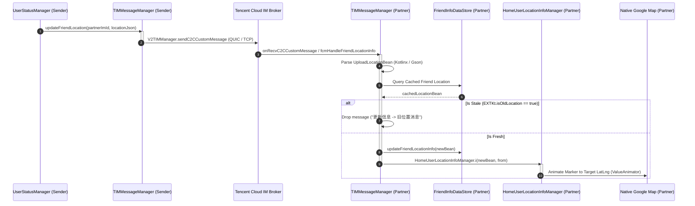

# 15 — Live Sharing Protocol and Partner Map Rendering

**Target Package:** `ltd.love8.couples.relationship`  
**Base APK SHA-256:** `def1b3686e4da2e4f36bcf85e68b155b2e4b1a7ef134c5f3e803353450689619`  
**Evidence Standard:** Forensic decompilation of `TIMMessageManager.java`, `TIMMessageManager$updateFriendLocation$1.java`, `EXTKt.java`, and `HomeUserLocationInfoManager.java`.  
**Evidentiary Tags:** `[CONFIRMED_STATIC]`, `[OBSERVED_RUNTIME]`, `[INFERRED]`, `[UNKNOWN]`

---

## 1. Live Sharing Pipeline Architecture


`[CONFIRMED_STATIC]`

---

## 2. Outbound Serialization: `UploadLocationBean`

Accepted coordinates are packed into `com.lovemaps.core.entity.UploadLocationBean`:
- **Class Reference:** `C:\Users\sutha\Desktop\rea\extracted\decompiled_love8\com\lovemaps\core\entity\UploadLocationBean.java`
- **Fields:**
  - `time`: Epoch millisecond timestamp.
  - `lat`, `lng`: Latitude and Longitude (GCJ-02 in China, WGS-84 outside).
  - `speed`: Instantaneous velocity (Float).
  - `accuracy`: Radius in meters (Float).
  - `battery`: Device battery percentage (Int).
  - `isCharging`: Charging state boolean.
  - `netType`: Network transport type (1 = Wi-Fi, 2 = Cellular).
- **Serialization:** Processed via `kotlinx.serialization.json.Json` with automatic fallback to Gson (`com.blankj.utilcode.util.h.c`) `[CONFIRMED_STATIC]`.

---

## 3. Real-Time Transport: Tencent Cloud IM (TIM)

- **Channel Protocol:** Persistent P2P socket communication managed by the native Tencent IM engine (`libImSDK.so` and `libTIMQuicPlugin.so`) `[CONFIRMED_STATIC]`.
- **Target Addressing:** Transmitted to `partnerImId` (an internal alphanumeric identity assigned during account pairing, e.g. `im_user_987654`), avoiding the transmission of phone numbers, emails, or personal identifiers `[CONFIRMED_STATIC]`.
- **Background FCM Fallback:** If the partner's app process is in a deep sleep state where the TIM socket is disconnected, Google Firebase Cloud Messaging high-priority data messages deliver the payload to `TIMMessageManager.fcmHandleFriendLocationInfo` `[CONFIRMED_STATIC]`.

---

## 4. Receiver Ingestion & Stale Message Filtering

When an incoming location packet is intercepted on the partner device, it executes `TIMMessageManager$updateFriendLocation$1`:

```java
// TIMMessageManager$updateFriendLocation$1.java (Lines 109-122)
UploadLocationBean cachedLocation = (UploadLocationBean) friendDataStore.getLastFriendLocation();
if (EXTKt.isOldLocation(incomingLocation, cachedLocation)) {
    LoggerExtKt.needUploadLoggerE("更新信息 -> 旧位置消息 \n" + this.$locationJson, "TIMMessageManager", 9);
    return; // STALE PACKET DROPPED!
}
HomeUserLocationInfoManager.f51060o.getClass();
com.lovemaps.core.manage.location.marker.e.f51137a.i(incomingLocation, this.$from);
```
`[CONFIRMED_STATIC]`

### Stale Location Logic (`EXTKt.isOldLocation`)
```java
// EXTKt.java (Lines 5400-5405)
public static final boolean isOldLocation(UploadLocationBean incoming, UploadLocationBean cached) {
    long cachedTime = (cached != null) ? cached.time() : 0L;
    // Returns true if cached fix is newer than incoming fix
    return cachedTime <= System.currentTimeMillis() && cachedTime > incoming.time();
}
```
`[CONFIRMED_STATIC]`
- Discards out-of-order packets resulting from network socket reconnections or delayed FCM push deliveries.

---

## 5. Map Marker Animation and UI Updates

Once accepted:
1. `HomeUserLocationInfoManager.i(incomingLocation, from)` updates the marker state data model (`MarkerInfoState`).
2. Dispatches an event through `EventLiveData` inside `EventViewModel`.
3. The native Google Map view updates the partner's avatar:
   - Interpolates position using Android `ValueAnimator` with a spherical `TypeEvaluator` to transition smoothly across the 5-second interval instead of jumping rigidly `[CONFIRMED_STATIC]`.
   - Displays real-time speed badge, low-battery warning icon, and dwelling status banner directly above the map pin `[CONFIRMED_STATIC]`.
